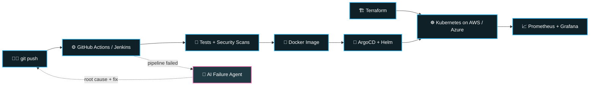

<div align="center">


<a href="https://github.com/chavanritesh18"></a>

<br/>

<a href="https://linkedin.com/in/ritesh-chavan-one8"></a>
<a href="https://instagram.com/the_ritesh18"></a>
<a href="mailto:chavanritesh322@gmail.com"></a>
<a href="https://ritesh18.vercel.app/"></a>
<a href="https://www.leetcode.com/the_ritesh"></a>
<a href="https://www.hackerearth.com/@chavanritesh322"></a>
<a href="https://auth.geeksforgeeks.org/user/lostboi"></a>


</div>

<br/>

## `$ whoami`

```yaml
apiVersion: human/v1
kind: Engineer
metadata:
  name: ritesh-chavan
  location: pune-india
  labels:
    role: devops-cloud-engineer
    focus: [ai-for-devops, system-design]
spec:
  clouds: [aws, azure]
  orchestration: kubernetes (aks)
  iac: [terraform, ansible]
  ci_cd: [jenkins, github-actions]
  gitops: [argocd, helm]
  observability: [prometheus, grafana]
  impact:
    release_frequency: "+40%"   # CI/CD pipelines
    monthly_cloud_spend: "-15%" # Terraform right-sizing
  creator: the-stack-engineer   # practical DevOps content
status:
  phase: Running 🚀
  ask_me_about: [kubernetes, terraform, ci-cd, gitops, ai-for-devops, system-design]
```

## 🔁 How I ship



## 🤖 AI × 🏗️ System Design

<table>
<tr>
<td valign="top" width="50%">

### 🤖 AI for DevOps
- AI agents that triage CI/CD pipeline failures and point to the root cause
- LLM-assisted Terraform plan reviews, ranked by risk
- NLP research internship: built a multilingual aggression-detection dataset (1,000+ annotated tweets) for model training

</td>
<td valign="top" width="50%">

### 🏗️ System Design
- Microservices on Kubernetes with high availability and autoscaling
- Event-driven architectures with Kafka
- Multi-environment delivery (dev → UAT → prod) with GitOps
- Cost-aware cloud architecture on AWS & Azure

</td>
</tr>
</table>

## 🛠️ Featured builds

<table>
<tr>
<td valign="top" width="50%">

### 🔐 Cloud-Native DevSecOps CI/CD Pipeline
End-to-end pipeline with automated tests, security scans and containerized deployments.

`GitHub Actions` `Terraform Cloud` `Docker` `Azure App Service`

</td>
<td valign="top" width="50%">

### 🧱 Cloud-Native 3-Tier DevOps App
Scalable 3-tier app with CI/CD and infrastructure as code.

`Node.js` `Docker` `Kubernetes` `AWS` `Terraform`

</td>
</tr>
<tr>
<td valign="top" width="50%">

### 🤖 CI/CD Failure Intelligence Agent
AI agent that automates the investigation of failed pipeline runs.

`Python` `FastAPI` `LLMs`

</td>
<td valign="top" width="50%">

### 📋 tf-explain
CLI that parses Terraform plan JSON and summarizes changes by risk.

`Terraform` `Python`

</td>
</tr>
</table>

## ⚡ Tech arsenal

<div align="center">

**Cloud & DevOps**


**AI, Data & Backend**


</div>

## 🏆 Certifications & wins

<div align="center">


<br/>


</div>

## 📊 GitHub activity

<div align="center">


<br/><br/>

<a href="https://www.buymeacoffee.com/chavanritesh"></a>

<br/><br/>

<i>Automate everything. Observe everything. Ship fearlessly.</i>

</div>


